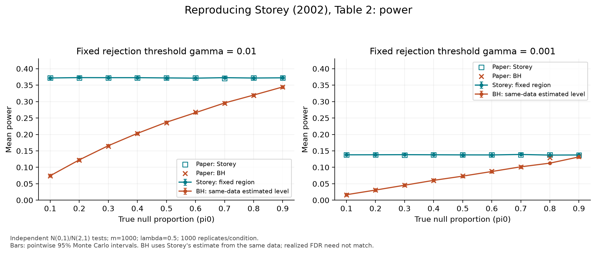
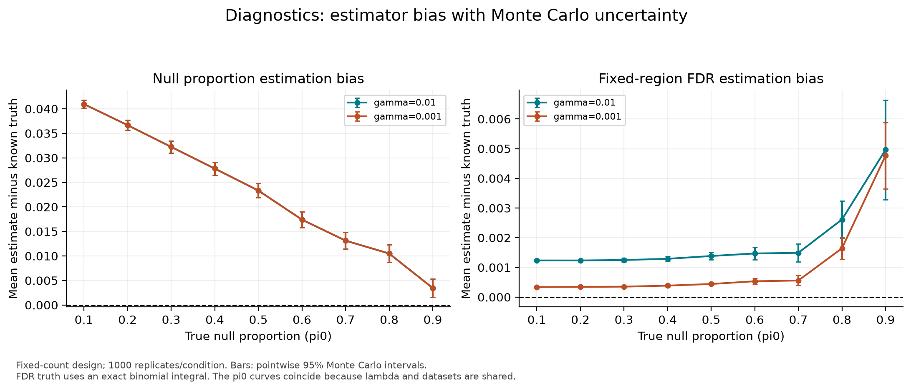

# Project 2 — Reproducing Storey (2002)

A reproducible simulation study of false discovery rate estimation and power, reproducing Section 5, Table 2 and Figure 1 of [Storey (2002), *A direct approach to false discovery rates*](https://genomics.princeton.edu/storeylab/papers/directfdr.pdf), with the [author's errata](https://genomics.princeton.edu/storeylab/papers/directfdr_corrections.pdf) considered explicitly.

The primary reproduction has 18 conditions: independent normal tests, 1000 hypotheses per replicate, 1000 replicates, alternative mean 2, lambda=0.5, pi0=0.1,…,0.9, and gamma=0.01/0.001. An additional 18 conditions use random labels; four boundary conditions check all-null/all-alternative behavior. There are 20,000 independent generated datasets, shared across the two gamma thresholds, and 120,000 method-level raw rows.

**Key findings:** Storey's fixed-region power is approximately 0.372 and 0.138 for the two thresholds, reproducing the paper's main pattern; one printed BH power entry differs materially. The paper's BH comparator uses a same-data estimated level, and observed FDR differs between methods, so the power advantage does not establish superiority at matched realized FDR.

## Setup

Tested with Python **3.13.12** on macOS ARM64. Use a Python 3.13 installation (with `venv` and `pip` available):

```bash
cd project2
python3.13 -m venv .venv
source .venv/bin/activate
python -m pip install -r requirements-lock.txt
make all
make test
```

Run these commands inside `project2/`, not the repository root. `requirements.txt` pins the direct dependencies; `requirements-lock.txt` also pins their installed transitive dependencies. No credentials, downloads, or external data are required to run the analysis after setup.

## Commands

| Command | Purpose |
|---|---|
| `make all` | Simulate or reuse a verified cache, analyze raw results, create all figures |
| `make simulate` | Save raw replicates and provenance before summarization |
| `make analyze` | Ensure raw output exists and is current, then regenerate summary tables |
| `make figures` | Ensure current summaries, then generate four figures in PNG and SVG |
| `make test` | Run 26 pytest cases, including analytic and end-to-end checks |
| `make smoke` | Small complete run under ignored `tmp/smoke/`; not submission results |
| `make clean` | Delete default generated results and smoke outputs; preserve reference Table 2 |

With the environment inactive, use `make all PYTHON=.venv/bin/python` and `make test PYTHON=.venv/bin/python`. The same interpreter override works for other targets. A clean full pipeline takes approximately **8–15 seconds** on this machine after dependency/font-cache initialization; allow longer on other machines. Installation is excluded. The simulation's measured runtime is in `results/raw/metadata.json`.

For a custom run:

```bash
make all CONFIG=config/smoke.json OUTPUT=tmp/custom
# Summarize existing raw output without invoking simulation:
python -m src.analyze --output results
# Force a fresh simulation rather than using a matching cache:
python -m src.simulation --config config/study.json --output results --force
```

Cache reuse requires matching configuration, source hashes, Python/package versions, and raw-file SHA-256. Config or source changes cause regeneration. The raw CSV is compressed but readable directly by pandas. `make clean` intentionally operates only on default `results/` generated files and `tmp/smoke/`; it does not recursively delete arbitrary custom output directories.

## Design and interpretation

Read [ADEMP.md](ADEMP.md) for the complete frozen design, estimands, formulas, random streams, and uncertainty calculations. The executable configuration is [config/study.json](config/study.json); [source notes](docs/source_notes.md) record the original design and interpretation choices before implementation.

The paper comparator is **BH at Storey's estimated FDR for that replicate**, not BH at a fixed 5%. This implementation also reports BH at a prespecified 0.05 for context. Storey's method fixes the p-value rejection threshold and estimates its FDR; it is not a procedure with a common prespecified FDR level across all conditions. FDR and pFDR are reported separately. pi0 estimation is clipped at one for use by the method, while its untruncated estimate is retained for diagnostics.

Fixed null counts are the primary interpretation of Section 5; iid Bernoulli null labels are an explicit sensitivity analysis reflecting the errata. The original seed and BH cutoff convention are unavailable, so this is an independently seeded numerical reproduction, not an exact replay of the original code.

## Outputs

- [ANALYSIS.md](ANALYSIS.md): critical analysis, including discrepancies and limitations; upload separately as required.
- [results/table2_comparison.csv](results/table2_comparison.csv): all six numerical columns compared with the transcribed published values, with differences and Monte Carlo standard errors.
- [results/summary.csv](results/summary.csv): power, empirical FDR/pFDR, cutoff and rejection count summaries with valid sample sizes and pointwise 95% Monte Carlo intervals.
- [results/diagnostics.csv](results/diagnostics.csv): bias, RMSE and clipping diagnostics.
- [results/paired_power.csv](results/paired_power.csv): within-dataset power differences and Monte Carlo uncertainty.
- [results/design_matrix.csv](results/design_matrix.csv): one row per simulation condition.
- [results/raw/](results/raw/): replicate-level CSV and provenance; [schema](docs/output_schema.md).

### Publication figure: power reproduction



### Diagnostic figure: estimator bias



Additional figures show [empirical FDR](results/figures/empirical_fdr.png) and [label sensitivity](results/figures/label_sensitivity.png). SVG versions in the same folder provide scalable figures. All error bars describe Monte Carlo precision, not bootstrap intervals from the paper.

## Project structure

```text
project2/
├── config/                 # full and smoke JSON designs
├── data/simulated/         # optional full-vector cache; unused (seed regeneration instead)
├── docs/                   # source audit, schema, validation record
├── src/
│   ├── dgps.py             # DGP and independent replicate streams
│   ├── methods.py          # Storey estimates and BH
│   ├── metrics.py          # realized metrics and analytic benchmarks
│   ├── simulation.py       # orchestration, caching, provenance
│   ├── analyze.py          # validation, summaries, paired comparisons
│   └── figures.py          # diagnostic and publication figures
├── results/
│   ├── raw/               # compressed replicates + metadata
│   ├── reference/         # Table 2 transcription, preserved by clean
│   └── figures/           # PNG/SVG
├── tests/
├── Makefile
├── ADEMP.md
├── ANALYSIS.md
├── requirements.txt
├── requirements-lock.txt
└── .gitignore
```

## Submission status

The code, documentation, results and tests are implemented. Review the analysis before submitting. The course requires a **publicly accessible repository URL**; the existing `daisy6932/stats607` repository is currently private and must be made public, or an approved public submission location must be arranged. No visibility change has been made. The assignment filename lists October 21 at 11 pm; confirm the deadline timezone on the course site.
