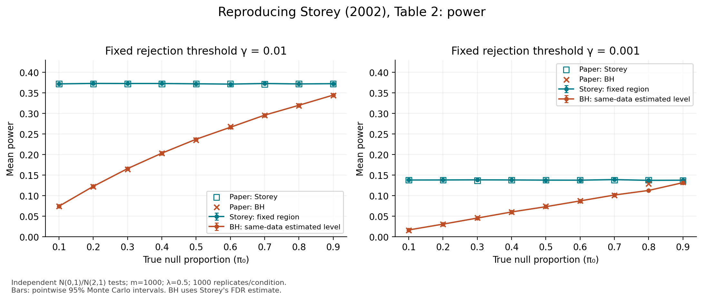
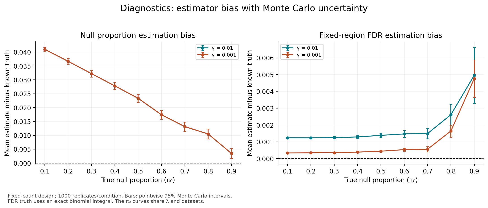

# Project 2 — Reproducing Storey (2002)

A reproducible simulation study of false discovery rate estimation and power, reproducing Section 5, Table 2 and Figure 1 of [Storey (2002), *A direct approach to false discovery rates*](https://genomics.princeton.edu/storeylab/papers/directfdr.pdf), using the [author's errata](https://genomics.princeton.edu/storeylab/papers/directfdr_corrections.pdf) to guide the label sensitivity analysis.

The main study uses 18 conditions from Table 2. Additional runs vary how null labels are assigned and check the all-null and all-alternative cases.

[ADEMP.md](ADEMP.md) explains the design and [config/study.json](config/study.json)
defines the conditions. In each replicate the paper's BH comparator uses Storey's
FDR estimate as its input level. The study also includes BH at a fixed level of 0.05.

**Key findings:** The simulation closely reproduces Table 2 except for one BH
power entry (about 0.113 here, 0.129 in the paper). Storey's higher power came
with higher observed FDR, so the comparison does not show an advantage at equal FDR.

## Run the study

From the repository root:

```bash
cd project2
make all
make test
```

Use Python 3.11 or later. `make all` creates `.venv`, installs dependencies,
and runs the study. Select an interpreter with `make all PYTHON_BIN=python3.11`.

Clean runs passed on macOS ARM64 with Python 3.11.18 (at the dependency
minimums) and 3.15.2. A full study run takes about 8–15 seconds after setup.

| Command | Output |
|---|---|
| `make all` | Set up the environment, run the simulation, and generate tables and figures |
| `make test` | Run the test suite |
| `make setup` | Create the environment and install dependencies |
| `make simulate` | Replicate data and run metadata |
| `make analyze` | Summary tables and Table 2 comparison |
| `make figures` | Four figures in PNG and SVG |
| `make smoke` | Small complete run in `tmp/smoke/` |
| `make clean` | Removes generated results and keeps the Table 2 reference |

To rerun the 10,000-replicate check at `pi0=0.8` and `gamma=0.001`:

```bash
make analyze CONFIG=config/followup.json OUTPUT=tmp/followup
```

The BH power and Monte Carlo standard errors are in `tmp/followup/summary.csv`
(rows with `method=bh_estimated` and `metric=power`).

## Outputs

- [Critical analysis](ANALYSIS.md)
- [Table 2 comparison](results/table2_comparison.csv) and [summary results](results/summary.csv)
- [Raw replicate data and metadata](results/raw/) ([column guide](docs/output_schema.md))

### Publication figure: power reproduction



### Diagnostic figure: estimator bias



Additional figures show [empirical FDR](results/figures/empirical_fdr.png) and [label sensitivity](results/figures/label_sensitivity.png). Error bars show 95% Monte Carlo intervals.

## Project structure

```text
project2/
├── config/                 # main, smoke, and follow-up configurations
├── data/simulated/         # optional simulation cache
├── docs/                   # output column guide
├── src/
│   ├── dgps.py             # DGP and independent replicate streams
│   ├── methods.py          # Storey estimates and BH
│   ├── metrics.py          # realized metrics and analytic benchmarks
│   ├── simulation.py       # orchestration, caching, provenance
│   ├── analyze.py          # validation, summaries, paired comparisons
│   └── figures.py          # diagnostic and publication figures
├── results/
│   ├── raw/               # compressed replicates + metadata
│   ├── reference/         # Table 2 transcription, preserved by clean
│   └── figures/           # PNG/SVG
├── tests/
├── Makefile
├── ADEMP.md
├── ANALYSIS.md
├── requirements.txt
├── requirements-lock.txt
└── .gitignore
```
